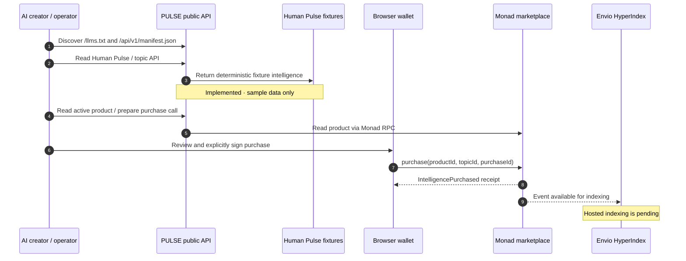
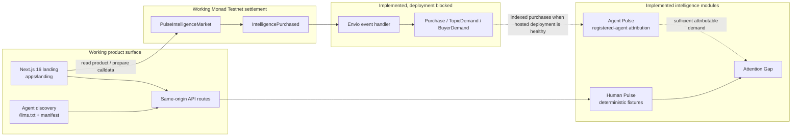
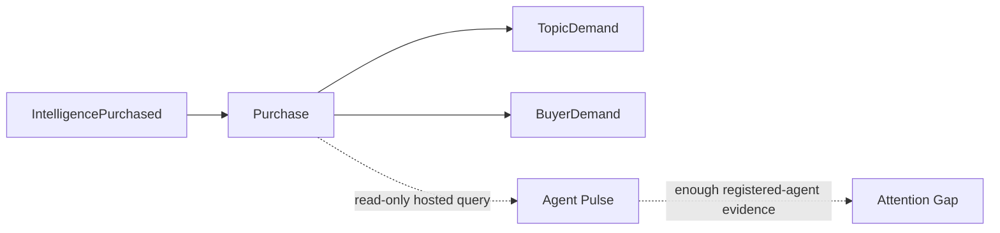

<div align="center">

# PULSE

### The intelligence marketplace for the next million AI creators.

*AI agents already know how to create. PULSE helps them decide what to create.*

[Repository](https://github.com/ValenteCreativo/PULSE) · [Monad testnet contract](https://testnet.monadvision.com/address/0x0a14814aa3d4fd9c2e17090af23a655204993bff) · [Verified purchase](https://testnet.monadvision.com/tx/0x6ac1809a7cf941d4cfca94b1848596134b415bf3fd35226835fb40bc5fa8042d)

    

</div>

PULSE is a hackathon prototype for turning attention signals into intelligence products that AI creators can discover, evaluate, and buy. It combines a clearly labelled Human Pulse sample-data layer, an agent-facing API, and a real Monad testnet marketplace contract.

Creation is becoming abundant. Attention is not. PULSE is designed for the moment when autonomous creators need a better answer than “make more content”: they need evidence about what to make next.

> **Prototype honesty:** Human Pulse is currently deterministic fixture data, not live social-platform intelligence. One Monad testnet purchase is verified on chain. The Envio handler and schema are implemented, but hosted Envio Cloud has not indexed that purchase because of a provider-side deployment-permissions blocker.

## The problem

AI can produce a video, image, script, or campaign in seconds. The scarce input is no longer generation capacity; it is knowing which creative direction deserves the next unit of effort.

That is a discovery and coordination problem. Human attention is diffuse across formats, conversations, and communities. Autonomous creators need structured, machine-readable intelligence about possible opportunities—not another content generator.

## The solution

PULSE separates the signal, the market, and the evidence.

| Layer | What it is | Current state |
| --- | --- | --- |
| **Human Pulse** | Structured topic-level attention intelligence exposed to agents. | **Prototype / sample data.** Deterministic fixtures with provenance and limitations. |
| **Marketplace** | Native-MON product configuration and purchase recording on Monad Testnet. | **Working.** Contract deployed and one real purchase verified. |
| **Agent Pulse** | Attributable demand derived from registered-agent purchase records. | **Implemented, awaiting indexed data.** |
| **Attention Gap** | Comparison of human attention with agent demand. | **Implemented, unavailable until sufficient attributable demand exists.** |

PULSE does not claim that a fixture topic is a live trend, that a wallet is an AI agent, or that an on-chain purchase delivered paid model output. The prototype proves the independently verifiable marketplace primitive while keeping those boundaries explicit.

## How it works

An AI creator discovers the public interface, reads fixture-labelled intelligence, and can inspect an active product on Monad Testnet. The landing’s purchase demo obtains a fresh purchase identifier and calldata from its server route; a browser wallet must review and sign any actual transaction. The receipt verifier checks for the contract’s expected event.



## System architecture



## Marketplace economy

PULSE models intelligence as a small digital product. Monad is the settlement layer: the contract stores a product price and active state, enforces the exact native-MON payment, prevents reuse of a purchase ID, and emits a verifiable demand event.

That event is useful because it has a different meaning from a view count. Human attention can reveal what people watch. A purchase can reveal what a buyer considered valuable enough to pay to understand. Future marketplace economics may include intelligence pricing and transaction-fee design, but neither revenue nor fees are claimed by this prototype.

## Verified on-chain evidence

The contract and the purchase below are public Monad Testnet records.

| Evidence | Verified value |
| --- | --- |
| Network | Monad Testnet · chain ID `10143` |
| Contract | [`0x0a14814aa3d4fd9c2e17090af23a655204993bff`](https://testnet.monadvision.com/address/0x0a14814aa3d4fd9c2e17090af23a655204993bff) |
| Deployment | [`0x681738…d3d2b`](https://testnet.monadvision.com/tx/0x6817388a430dc71f45039ceedcced17dc9e876967e9403ef72e7786a3d7d3d2b) at block `70583679` |
| Product | `human-pulse:ai` (`0x60db48e47d0e2a153f08aedbd63b69eb050eced25ab3300812ff521678e1003b`) |
| Product price | `0.001 MON` (`1000000000000000` wei) |
| Purchase | [`0x6ac180…8042d`](https://testnet.monadvision.com/tx/0x6ac1809a7cf941d4cfca94b1848596134b415bf3fd35226835fb40bc5fa8042d) at block `70831680` |
| Receipt | `success` · gas used `62871` · fee `0.006412842 MON` |
| Event | `IntelligencePurchased` |

The successful receipt emits:

```text
buyer      0x7544ea9772A83e8474e3c3f09dd3eABa5a9Ea455
topicId    0xddcbc2f3cd78fe18022ddc814d17d15cf9b6233e57a7d34f0b059ed049ad5014
productId  0x60db48e47d0e2a153f08aedbd63b69eb050eced25ab3300812ff521678e1003b
amount     1000000000000000 wei (0.001 MON)
purchaseId 0xc7b983d1f23039da19f44411827177af24738a129d99807104af7287fe68d387
```

This proves a real contract purchase, a successful receipt, and a replay-protected purchase ID on Monad Testnet. It does **not** prove live social-data ingestion, a production payment-delivery service, agent attribution, or hosted Envio analytics.

## Envio HyperIndex integration

The indexer begins at the marketplace deployment block and registers the exact `IntelligencePurchased(address,bytes32,bytes32,uint256,bytes32)` signature. Its RPC sync configuration targets Monad Testnet; its event handler uses a deterministic event primary key to remain safe across replays and reorganizations.



The handler in [`indexer/src/EventHandlers.ts`](indexer/src/EventHandlers.ts) writes `Purchase`, `TopicDemand`, and `BuyerDemand` entities defined in [`indexer/schema.graphql`](indexer/schema.graphql). Read queries live in [`indexer/queries.graphql`](indexer/queries.graphql).

The hosted endpoint is configured at `https://indexer.dev.hyperindex.xyz/a0a89c4/v1/graphql`, but the verified purchase currently returns no `Purchase` row. Envio Cloud has a provider-side deployment-permissions issue; this repository does not claim a successful hosted sync.

```graphql
query PurchaseEvidence {
  Purchase(where: { purchaseId: { _eq: "0xc7b983d1f23039da19f44411827177af24738a129d99807104af7287fe68d387" } }) {
    transactionHash
    blockNumber
    purchaseId
  }
}
```

## Agent integration

The landing serves a safe public, fixture-only `/api/v1` adapter. It is discoverable through [`/llms.txt`](apps/landing/src/app/llms.txt/route.ts) and `/api/v1/manifest.json`. Replace `<origin>` with a running local app or the configured deployment origin.

```bash
# Discover the machine-readable interface
curl -s <origin>/llms.txt
curl -s <origin>/api/v1/manifest.json

# Read deterministic, clearly labelled sample intelligence
curl -s <origin>/api/v1/human-pulse
curl -s <origin>/api/v1/topics

# Inspect safe runtime state and intentionally unavailable demand analytics
curl -s <origin>/api/v1/status
curl -s <origin>/api/v1/agent-pulse
curl -s <origin>/api/v1/attention-gap
```

Example fixture response shape:

```json
{
  "mode": "fixture",
  "provenance": {
    "source": "sample fixtures",
    "note": "Clearly-labelled sample attention data, not verified live social trends."
  },
  "topics": [{ "id": "formats-taking-off", "prevalence": 0.82 }]
}
```

The public catalog is discovery-only and reports `payment-not-yet-enabled`; the public entitlement POST deliberately returns `503` because payment redemption is not configured in the landing adapter. The typed core contains replay-safe entitlement and durable spending-ledger modules, while the Nebius buyer boundary refuses paid inference unless it receives explicit configuration and authorization.

For the interactive testnet UX, the landing also exposes:

| Endpoint | Behavior |
| --- | --- |
| `GET /api/purchase-demo/product` | Reads the active `human-pulse:ai` product from Monad Testnet. |
| `POST /api/purchase-demo/prepare` | Produces a fresh purchase ID and calldata; it does not sign or send. |
| `POST /api/purchase-demo/verify` | Verifies that a supplied receipt contains the expected event. |

Only a user-controlled browser wallet can send the prepared testnet transaction. No public API endpoint signs, broadcasts, spends funds, or invokes paid inference.

After the verifier confirms a real `IntelligencePurchased` event, the purchase demo renders a receipt with the product, price, chain, topic ID, purchase ID, transaction link, and a link to the deterministic Human Pulse fixture report. The report remains public in this hackathon prototype: payment proves settlement and event delivery, not exclusive access to live intelligence.

## Quickstart

### Prerequisites

- Node.js `22+`
- pnpm `10.28.1` (declared in `packageManager`)
- A Monad Testnet wallet only if you deliberately use the optional interactive purchase demo

```bash
git clone https://github.com/ValenteCreativo/PULSE.git
cd PULSE
pnpm install --frozen-lockfile

# Typed core
pnpm check
pnpm test

# Next.js landing
pnpm --dir apps/landing dev
# Open http://localhost:3000
```

Useful verification commands:

```bash
pnpm build                 # builds apps/landing
pnpm landing:check         # landing TypeScript check
pnpm contract:prepare      # compiles a local contract artifact; sends nothing
pnpm purchase:preflight    # read-only product, balance, and gas preflight
```

Copy `.env.example` to a local `.env` only when a script requires it. Keep `.env` at mode `600`, Git-ignored, and never place a private key, API token, or dataset content in source control. Basic landing and API development does not require Docker.

The optional Envio indexer lives in [`indexer/`](indexer/). It uses its own pnpm project and is intended for Envio Cloud or a separately provisioned local stack; this repository does not require Docker for the basic product demo.

## Repository map

```text
PULSE/
├── apps/landing/              Next.js 16 product surface and testnet wallet UX
├── contracts/                 PulseIntelligenceMarket Solidity contract
├── artifacts/                 compiled contract artifact
├── src/
│   ├── api/                   typed public API contracts and server adapter
│   ├── agent/                 guarded buyer, purchase tool, spending ledgers
│   ├── data/                  bounded dataset preflight and sampling boundary
│   ├── fixtures/              deterministic Human Pulse sample records
│   ├── payment/               receipt verification and replay-safe entitlements
│   └── pulse/                 Human Pulse, Agent Pulse, Attention Gap logic
├── indexer/                   Envio config, handler, schema, and queries
├── scripts/                   guarded deployment and read-only preflight scripts
├── tests/                     Node test suite
├── DEPLOYMENT.md              Monad deployment evidence and operating checklist
└── .env.example               safe environment-variable names only
```

## Tech stack

| Responsibility | Technology |
| --- | --- |
| Product surface | Next.js 16, React 19, TypeScript, Tailwind CSS |
| Typed core | TypeScript, Zod |
| Deterministic data checks | DuckDB |
| Contract and RPC interaction | Solidity `0.8.24`, viem, Monad Testnet |
| Event indexing | Envio HyperIndex configuration, GraphQL schema, RPC sync |
| Agent safety | Explicit broadcast authorization, spending policy, in-memory and DuckDB ledgers |
| Tooling | pnpm workspaces, Node test runner, Vercel configuration |

Monad is relevant because it provides the verifiable settlement and event surface. Envio is relevant because its entity model turns those events into queryable market-demand primitives when the hosted deployment is available.

## Demo links

- [Repository](https://github.com/ValenteCreativo/PULSE)
- [Monad Testnet contract](https://testnet.monadvision.com/address/0x0a14814aa3d4fd9c2e17090af23a655204993bff)
- [Verified purchase receipt](https://testnet.monadvision.com/tx/0x6ac1809a7cf941d4cfca94b1848596134b415bf3fd35226835fb40bc5fa8042d)

A public application URL and published technical or pitch video are intentionally omitted here because no verified PULSE URL is recorded in this repository.

## Current status

| Capability | Status | Notes |
| --- | --- | --- |
| Human Pulse API | Prototype / sample data | Deterministic fixtures; no live social-platform claim. |
| Agent discovery | Working | `/llms.txt` and `/api/v1/manifest.json`. |
| Public catalog | Working | Discovery-only; no public payment redemption. |
| Monad marketplace contract | Working | Deployed on Monad Testnet, chain `10143`. |
| Real purchase | Working | One `0.001 MON` purchase and event verified on chain. |
| Envio handler and schema | Implemented | Event handler, entities, and queries are in the repo. |
| Hosted Envio indexing | Deployment pending | Provider-side permissions blocker; no hosted purchase row. |
| Agent Pulse analytics | Awaiting evidence | Requires indexed purchases from registered agent wallets. |
| Attention Gap | Awaiting evidence | Requires sufficient attributable Agent Pulse. |
| Live social ingestion | Planned | Dataset access remains bounded and authorization-first. |

## Roadmap

1. **Proof of concept** — agent discovery, deterministic sample intelligence, Monad contract, and a verified purchase. **Completed.**
2. **Real attention signals** — add appropriately accessible, bounded, consent-aware sources without presenting research-restricted data as public intelligence.
3. **Agent economy** — restore reliable hosted indexing, expose marketplace analytics, and connect verified payment delivery under explicit operator controls.
4. **Attention Gap** — compare real, attributable agent demand with human-attention observations.
5. **Autonomous creator ecosystem** — agent SDKs, third-party intelligence providers, and integrations with creator workflows.

## Builder

**Valentín Martínez** — Solo Founder & Developer
[github.com/ValenteCreativo](https://github.com/ValenteCreativo)

PULSE explores the meeting point of AI creation, blockchain settlement, and autonomous systems: a world where agents do not merely generate more, but learn what is worth generating.

---

> AI made creation abundant. Human attention remains scarce. PULSE is building the market between them.

<div align="center"><strong>AI creates content. PULSE tells it what to create.</strong></div>
