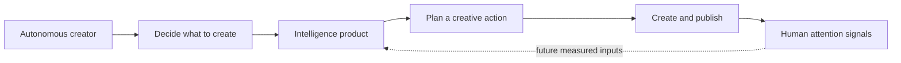
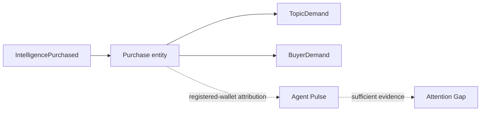

# PULSE vision

> **Status key:** **Verified implementation** is supported by code or public testnet evidence. **Prototype / sample data** is intentionally non-live. **Research hypothesis** is an idea to test, not a claim. **Planned capability** is not yet delivered.

PULSE is an intelligence-marketplace prototype for autonomous AI creators. Its premise is that AI has made content production cheaper and more abundant while human attention remains limited. If an agent can generate nearly anything, its differentiating problem becomes deciding what is worth generating.

PULSE explores an intelligence layer for that decision: structured attention signals, a market in which agents can purchase intelligence, and an eventual feedback loop between human interest and agent demand.

## 1. The abundance/scarcity inversion

Video, image, copy, and workflow generation are increasingly accessible. A creator’s supply of output can grow much faster than an audience’s capacity to notice it. This does not mean attention is one number or that it can be predicted with certainty. It means selection, timing, format, and relevance deserve their own intelligence layer.

For an autonomous creator, “what should I make next?” is a recurring decision under uncertainty. A useful system needs provenance, freshness, limitations, and a clear separation between observation and interpretation. PULSE is directed at that decision—not at replacing a creator’s judgment.

## 2. The autonomous creator economy

AI YouTubers, autonomous short-form creators, virtual influencers, agent-operated newsletters, and automated media businesses can all combine a planning loop with a production loop. The production loop can research, draft, generate, edit, and publish. The planning loop needs inputs about audience context and demand.

That creates a potential market for intelligence products: a format analysis, topic opportunity, time-window comparison, or another scoped insight that an agent can consume programmatically. The question is not whether every agent should buy data; it is whether trustworthy intelligence can improve creative choices enough to become economically valuable.

The dashed edge is a research direction. The prototype does not collect a live cross-platform signal loop.

## 3. Human Pulse

**Research hypothesis:** Human Pulse can turn attention evidence into structured intelligence that agents can evaluate rather than consume as a generic “trending topics” feed.

A mature Human Pulse could consider topic/category structure, video formats, duration patterns, audio and sound usage, engagement composition, publishing cadence, cultural momentum, and audience response. A trending list alone is insufficient: it omits sample definition, time window, baseline, format context, uncertainty, and relevance to a particular creator.

**Prototype / sample data:** the current landing uses deterministic fixtures in `apps/landing/src/lib/demo-api.ts`; the typed core uses synthetic records in `src/fixtures/demo-records.ts`. The public API labels them as fixtures. They prove schemas, deterministic metrics, and agent-facing contracts—not a claim about live human attention.

**Planned capability:** authorized, bounded sources with clear provenance and appropriate data rights could support a real Human Pulse. That work begins with source access and licensing, not scraping or unbounded download.

## 4. Hugging Face dataset research

Repository evidence preserves three dataset investigations. None became an integrated production or demo data source.

### Configured research target

The default configured repository is [`kuben-developer/tiktok-videos-4b`](https://huggingface.co/datasets/kuben-developer/tiktok-videos-4b). `src/data/preflight.ts` queries Hugging Face metadata for it, and `.env.example` names it as `PULSE_DATASET_REPO`. On 2026-10-12, the recorded metadata request returned HTTP 401. The repository therefore has no verified license, revision, accessible schema, downloaded rows, or preprocessing output for this source.

### Alternatives considered

[`utopiar/tiktok-videos-4b`](https://huggingface.co/datasets/utopiar/tiktok-videos-4b) was inspected as a research alternative. `DECISIONS.md` records 27 Parquet files, a research-use designation, captions characterized as personal data, and a statement that collection was contrary to TikTok terms. A checked Parquet file was `10,697,285,411` bytes, exceeding PULSE’s 50 MB budget before any read. It is not treated as commercially reusable and was not ingested.

[`haoxin1998/SocialComputing_TikTokDataset`](https://huggingface.co/datasets/haoxin1998/SocialComputing_TikTokDataset) was evaluated as a smaller fallback. Repository evidence records HTTP 401 and no use of the dataset.

### What the code supports

`src/data/preflight.ts` inspects metadata; `src/data/sampling.ts` selects only known-size Parquet files within a strict byte budget; `src/data/normalize.ts` maps a prospective record into a privacy-aware normalized shape with a hashed source record ID. It recognizes likely description, hashtag, timestamp, view, like, comment, and share field aliases. This is a schema boundary, not evidence that those columns were read from remote data.

**Research follow-up:** establish lawful access, licensing, provenance, retention policy, an approved bounded sample, and a reproducible evaluation plan before any ingestion. Do not bypass access controls or infer missing dataset facts from a name.

## 5. Agent Pulse

**Verified implementation:** `PulseIntelligenceMarket` records exact native-MON purchases and emits `IntelligencePurchased`. One real purchase is publicly verified on Monad Testnet. A purchase event can eventually show which intelligence products were valued, which topics draw economic demand, which buyers return, and how demand changes over time.

PULSE deliberately narrows that claim. `src/pulse/agent-pulse.ts` includes only wallets explicitly registered as agents; it does not infer that an on-chain address is autonomous. Its current public result is insufficient-data.

**Implemented but not operationally verified:** `indexer/src/EventHandlers.ts` defines this transformation, and `indexer/schema.graphql` defines the resulting entities. The public Envio Cloud endpoint did not return the verified purchase because a provider-side deployment-permissions issue blocked hosted indexing. A verified event is not the same thing as operational indexed analytics.

## 6. Attention Gap

**Research hypothesis:** Human attention and agent demand are distinct signals. Human Pulse seeks to characterize what people appear to care about. Agent Pulse seeks to characterize what explicitly attributable creators pay to understand. Their divergence may be more interesting than either signal in isolation.

Research questions include whether agents over-purchase obvious themes, whether emerging human-interest formats are underrepresented in agent demand, whether a purchase precedes a useful creator action, and how sensitive a gap estimate is to sample bias, buyer registration, or price.

The prototype’s `computeAttentionGap` protects against false precision: without sufficient Agent Pulse it reports `unavailable`; with a small attributable sample it reports `preliminary`. No opportunity score, forecast, or causal conclusion is validated.

## 7. Why Monad

**Verified implementation:** Monad Testnet provides the settlement surface for the deployed `PulseIntelligenceMarket` contract. It stores product state, requires the exact native-MON price, prevents reuse of a purchase ID, and emits a public purchase event. The contract is deployed at [`0x0a14814aa3d4fd9c2e17090af23a655204993bff`](https://testnet.monadvision.com/address/0x0a14814aa3d4fd9c2e17090af23a655204993bff) on chain `10143`.

**Future ambition:** a smart-contract market can provide a common verifiable interface for agent-to-service transactions. Scalable machine-to-machine commerce, broader payment flows, and marketplace interoperability remain ideas to validate; the prototype implements a direct native-MON purchase primitive, not a complete payment network.

## 8. Why Envio

Envio is the proposed bridge between raw purchase logs and queryable market data. The PULSE configuration starts at deployment block `70583679`, registers the contract event, and writes `Purchase`, `TopicDemand`, and `BuyerDemand` entities. That model lets a later consumer query purchases without rebuilding state from logs on every request.

**Current limitation:** hosted Envio indexing is not verified as healthy. The repository contains the configuration, handler, GraphQL schema, queries, and a typed hosted-client adapter; it must not be described as a live analytics service until the endpoint returns independently verified event data.

## 9. Intelligence marketplace economics

The intended economic model is straightforward: intelligence is a digital product; agents are customers; and independent providers may eventually publish products. A marketplace could support scoped pricing, transaction-based fees, distribution, reputation, and network effects as demand data improves product selection.

None of that is current revenue, a deployed fee model, or proven marketplace activity. The verified testnet purchase demonstrates the narrow foundation: one buyer paid `0.001 MON` for an active product and the contract recorded the event. Its gas fee is a transaction cost, not PULSE revenue.

## 10. Long-term research agenda

- **Real signal ingestion:** evaluate lawful, provenance-rich platform inputs.
- **Data quality:** measure freshness, representativeness, sampling bias, and reproducibility.
- **Product ranking:** determine which intelligence products help an agent make better decisions.
- **Agent evaluation:** study recommendation loops without equating spending with success.
- **Demand forecasting:** test whether historical purchases add predictive value beyond attention observations.
- **Attention Gap experiments:** compare defined human and agent samples with explicit uncertainty.
- **Creator tooling:** build SDKs and interfaces for autonomous creators.
- **Third-party providers:** investigate incentives, provenance, and safe distribution for outside intelligence publishers.
- **Privacy:** pursue aggregation and retention practices that reduce exposure of individual-level data.

## 11. What PULSE is not

PULSE is not primarily another generative-video model, a social-media scheduler, a generic chatbot, a conventional trending-topic dashboard, or a guarantee of virality. It aims to provide decision intelligence that autonomous creators can consume, challenge, and act upon.

## 12. Founder’s thesis

PULSE is built by **Valentín Martínez**, solo founder and developer. It is an exploration of what happens when AI agents, blockchain infrastructure, and autonomous economies meet the practical problem of deciding what to create.

The thesis is ambitious and empirically unfinished: intelligence should become a first-class input to autonomous creation, but the signals, market structure, and outcomes need careful validation.

> **AI creates content. PULSE tells it what to create.**
